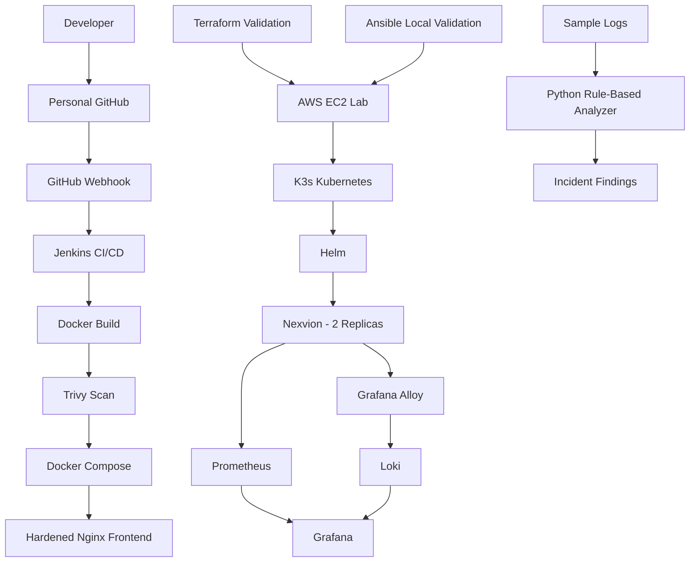

# Nexvion DevOps Platform Architecture

## Overview
Nexvion is a frontend-only e-commerce demonstration platform for DevOps and cloud-native delivery practices.

## Architecture

## Technology Stack
- Ubuntu Linux, Git and GitHub
- Jenkins and GitHub Webhook
- Docker and Docker Compose
- Trivy and Gitleaks
- Terraform and Ansible
- K3s Kubernetes and Helm
- Prometheus, Node Exporter and Kube State Metrics
- Grafana, Grafana Alloy and Loki
- Python incident analyzer

## Deployment Flow
1. GitHub webhook triggers Jenkins.
2. Jenkins validates source, builds the image and scans it.
3. Jenkins deploys and verifies the frontend using Docker Compose.
4. Helm manages the separate Kubernetes deployment.
5. Prometheus collects metrics and Grafana visualizes them.
6. Alloy forwards Kubernetes pod logs to Loki.
7. Python analyzes sample logs using predefined rules.

## Limitations
- Nexvion is a static frontend demo, not a complete backend e-commerce application.
- No real payment processing or backend order service exists.
- Terraform validates an imported security group; it does not provision the complete AWS environment.
- Ansible validation uses a local inventory.
- Kubernetes is a single-node lab cluster.
- The incident analyzer uses predefined rules, not live LLM inference.
- This is a learning environment, not a production high-availability architecture.
